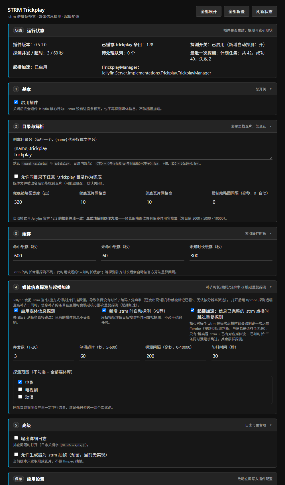

# STRM Trickplay

**让 Jellyfin 里的 `.strm`（网盘 / 远端直链）条目也能拥有进度条缩略图预览，并顺带补齐媒体信息、加快起播。**

| 项目 | 值 |
|---|---|
| 适配 | **Jellyfin 12.2**（`targetAbi 12.2.0.0`，.NET 10） |
| 当前版本 | **0.5.1.0** —— 每个版本改了什么见 [CHANGELOG.md](CHANGELOG.md) |
| 三项能力 | ① 进度条预览（trickplay） ② 媒体信息探测（时长/编码/分辨率） ③ 起播加速 |
| 插件存储库 | `https://raw.githubusercontent.com/tang-bai/strm-trickplay/main/docs/manifest.json` |
| 实测状态 | 已在真实 **Jellyfin 12.2.0** 服务端逐项验证，命令与原始输出见 [TEST-REPORT.md](TEST-REPORT.md) |
| 许可 | MIT（[LICENSE](LICENSE)） |

> **一句话概括**：Jellyfin 把 `.strm` 当"快捷方式 + 远端媒体源"，于是三件事同时缺失 —— 不认现成的 trickplay 瓦片、库扫描不探测媒体信息、每次点播还要重复探测一次。本插件用两个装饰器补齐这三点：**不写数据库、不碰本地媒体、卸载无残留**。

## 目录

- [1. 它能解决什么](#1-它能解决什么)
- [2. 快速开始（三分钟）](#2-快速开始三分钟)
- [3. 安装 / 升级 / 卸载](#3-安装--升级--卸载)
- [4. 瓦片目录与文件规范](#4-瓦片目录与文件规范)
- [5. 能力① 进度条预览](#5-能力-进度条预览)
- [6. 能力② STRM 媒体信息探测](#6-能力-strm-媒体信息探测)
- [7. 能力③ 起播加速](#7-能力-起播加速)
- [8. 配置项](#8-配置项)
- [9. 诊断接口与日志](#9-诊断接口与日志)
- [10. 故障排查](#10-故障排查)
- [11. 已知限制与兼容性](#11-已知限制与兼容性)
- [12. 开发、发版与文档](#12-开发发版与文档)
- [13. 许可证与致谢](#13-许可证与致谢)

---

## 1. 它能解决什么

### 1.1 你遇到的现象

网盘 / 影视库用 `.strm` 挂载后：

- **播放时进度条上悬停没有缩略图预览**，而同一部片子如果是本地文件入库，预览却正常；把 `<影片名>.trickplay` 目录放到 strm 旁边也没用；
- 影片**没有时长、编码、分辨率**，甚至**播几秒就被标记为"已看"**，也没法按分辨率 / 编码筛选；
- 点开一部片子要**等上一会儿才出画面**（每次点播都在对远端直链跑一次 ffprobe）。

### 1.2 根本原因（源码级，v12.2 实测核实）

| # | 事实 | 源码位置 |
|---|---|---|
| 1 | `.strm` 条目被标记为 **shortcut** | `Emby.Server.Implementations/Library/Resolvers/BaseVideoResolver.cs:147` |
| 2 | strm 内是 http(s) 直链时，媒体源被标记 **`IsRemote = true`**（Jellyfin 出于安全只接受远端 URL） | `MediaBrowser.Controller/Entities/BaseItem.cs:1239-1250` |
| 3 | **核心的 trickplay 清单会跳过 remote 媒体源** → `BaseItemDto.Trickplay` 恒为空 → 网页端拿不到预览数据 | `Jellyfin.Server.Implementations/Trickplay/TrickplayManager.cs:746` |
| 4 | 12.x 虽已能"发现磁盘上现成的 `.trickplay` 目录"，但入口 `CanGenerateTrickplay` **明确排除 shortcut**，对 strm 永不执行 | 同文件 `:285` 调用、`:650` |
| 5 | Web 客户端的预览**只认 DTO 里那个字段** | jellyfin-web `apps/legacy/controllers/playback/video/index.js:144` |
| 6 | 库扫描**不会**为 strm 跑 ffprobe（视为快捷方式），媒体信息只会在**首次播放**时补上 | `MediaBrowser.Providers/MediaInfo/ProbeProvider.cs` |
| 7 | 更"坑"的是：`GetPlaybackMediaSources` 按**路径后缀**判断，**只要是 `.strm` 就每次点播强制 `EnableRemoteContentProbe = true` 的 FullRefresh**，而探测端没有"已有信息就跳过"的判断 | `Emby.Server.Implementations/Library/MediaSourceManager.cs`、`FFProbeVideoInfo.cs` |

**结论**：不是你的目录放错了，也不是刮削失败 —— 是核心在"入口"和"出口"两处把 strm 的数据丢掉了；而"起播慢"则是设计使然（第 6、7 条）。

### 1.3 插件做了什么

两个装饰器，各管一段，互不干扰：

```
                        ┌──────────────────────────────────────────────┐
jellyfin-web / 客户端 ──►│  ITrickplayManager                           │
  DTO Trickplay 清单    │    └─ StrmTrickplayManager（本插件）         │  ← 能力①：补读路径
  瓦片图 / tiles.m3u8   │         · .strm → 解析同级 .trickplay 目录   │
                        │         · 其它条目 → 原样透传                │
                        └──────────────────────────────────────────────┘

                        ┌──────────────────────────────────────────────┐
点播（PlaybackInfo）  ──►│  IMediaSourceManager                         │
                        │    └─ StrmMediaSourceManagerDecorator（本插件）│  ← 能力③：起播加速
                        │         · 信息已完整的 .strm → 跳过重复探测   │
                        │         · 其余（含未探测条目/本地/直播）→ 透传│
                        └──────────────────────────────────────────────┘

                        ┌──────────────────────────────────────────────┐
库扫描 / 新增条目     ──►│  IStrmProbeService（本插件）                  │  ← 能力②：媒体信息探测
计划任务 04:00        │    └─ ffprobe 远端直链 → 补齐时长/编码/分辨率 │
                        └──────────────────────────────────────────────┘
```

设计原则：**只补读路径与探测**，不写自有数据库、不改本地媒体的既有行为；插件对非 strm 条目完全透明。

### 1.4 装前 / 装后对照（实测）

| | 装插件前 | 装插件后 |
|---|---|---|
| DTO `Trickplay` 字段 | 空 | `{"320":{"Width":320,"Height":9,"TileWidth":10,"TileHeight":10,"ThumbnailCount":300,"Interval":10000}}` |
| `Videos/{id}/Trickplay/320/0.jpg` | 404 | `200 image/jpeg`（来自你的 `.trickplay` 目录） |
| `.../Trickplay/320/tiles.m3u8` | 404 | 正常的 `#EXT-X-TILES` 播放列表 |
| 网页播放悬停进度条 | 无预览 | 缩略图气泡 |
| 影片时长 / 分辨率 | 空（播过才有） | 探测后即有，可按分辨率筛选 |
| 点播起播 | 每次都要等一次远端 ffprobe | 信息完整后跳过（能力③） |

---

## 2. 快速开始（三分钟）

1. **加存储库**：控制台 → 插件 → 存储库 → 添加，URL 填

   ```
   https://raw.githubusercontent.com/tang-bai/strm-trickplay/main/docs/manifest.json
   ```

2. **安装**：切到 **目录** 标签，搜 **STRM Trickplay** → 安装；
3. **重启 Jellyfin**（控制台右上角 ⚙ → 重启）；
4. **验收**：打开一部 strm 影片，鼠标悬停进度条应出现缩略图气泡；影片详情页应显示时长。

没生效？按 [第 9 节](#9-诊断接口与日志) 的顺序查三步即可定位。

---

## 3. 安装 / 升级 / 卸载

### 3.1 在线安装（推荐，可自动更新）

1. **控制台 → 插件 → 存储库**（Dashboard → Plugins → Repositories）→ **添加 / +**：
   - 名称：`STRM Trickplay`（随便填）
   - URL：`https://raw.githubusercontent.com/tang-bai/strm-trickplay/main/docs/manifest.json`
2. 保存后切到 **目录** 标签，搜索 **STRM Trickplay** → **安装**；
3. 按提示**重启 Jellyfin**；
4. 以后发新版，插件页会直接提示升级。

> 觉得 raw 链接太长？在仓库 `Settings → Pages` 把 Source 设为 **分支 main / 目录 /docs**，即可改用
> `https://tang-bai.github.io/strm-trickplay/manifest.json`（内容完全一样）。

### 3.2 离线安装（zip）

1. 到 [Releases](https://github.com/tang-bai/strm-trickplay/releases) 下载 `strm-trickplay_<版本>.zip`；
2. **校验完整性**（Release 里同时提供 `.md5` 与 `.sha256`）：

   ```bash
   # Linux / macOS / Git Bash：把 <版本> 换成实际版本号
   md5sum -c strm-trickplay_<版本>.zip.md5        # 期望输出 ...: OK
   sha256sum -c strm-trickplay_<版本>.zip.sha256
   ```
   ```powershell
   # Windows PowerShell
   (Get-FileHash .\strm-trickplay_<版本>.zip -Algorithm MD5).Hash
   ```

3. 解压到 Jellyfin 插件目录（目录名可自定义，但两个文件要同级）：

   ```
   <jellyfin-data>/plugins/StrmTrickplay/
   ├── Jellyfin.Plugin.StrmTrickplay.dll
   └── meta.json
   ```

4. **重启 Jellyfin**。

### 3.3 各平台插件目录

| 部署方式 | 插件目录 |
|---|---|
| Windows（安装版 / 便携版） | `%LOCALAPPDATA%\jellyfin\plugins\` |
| Linux（服务 / 包管理安装） | `/var/lib/jellyfin/plugins/` |
| Linux（用户态运行） | `~/.local/share/jellyfin/plugins/` |
| Docker | `/config/plugins/`（就是映射到 `/config` 的宿主机目录） |
| macOS | `~/.local/share/jellyfin/plugins/` |

> 只放 DLL 也能加载，但缺少 `meta.json` 时版本信息不准、也无法被存储库识别，**不推荐**。

### 3.4 升级与卸载

- **升级**：存储库方式在插件页点升级后重启；离线方式用新 zip 覆盖同目录文件后重启。
- **卸载**：控制台 → 插件 → 卸载（或删掉 `plugins/StrmTrickplay/`）→ 重启。
  插件不写自有数据库，卸载后无残留；媒体目录里的 `.trickplay` 原样保留。
  媒体信息探测写入的是 Jellyfin 自身的媒体流 / 时长字段，属于正常元数据，卸载后仍可继续使用。

### 3.5 安装成功的三个标志

1. **控制台 → 插件** 里出现 `STRM Trickplay`，状态为启用；
2. 日志里出现（关键字 `[StrmTrickplay]`）：

   ```
   [INF] ...StrmTrickplayManager: [StrmTrickplay] ITrickplayManager 装饰器已生效，回退实现: "Jellyfin.Server.Implementations.Trickplay.TrickplayManager"
   [INF] ...LibraryChangeListener: [StrmTrickplay] 已挂接媒体库变更事件（ItemAdded / ItemUpdated / ItemRemoved）
   ```

3. 跑一次自检接口（`<APIKEY>` 用管理员密钥，控制台 → API 密钥 里创建）：

   ```bash
   curl -X POST -H "Authorization: MediaBrowser Token=<APIKEY>" \
        "http://<服务器>:8096/Plugins/StrmTrickplay/SelfTest"
   ```

   期望返回 `parsedCount: 1`、`Width: 320`、`tileFileCount: 3`。这一条过了，说明插件已加载、DI 覆盖生效、解析器正常。

---

## 4. 瓦片目录与文件规范

### 4.1 前置条件

- `.strm` 里必须是**远端直链**：`http://`、`https://`、`rtsp://`、`rtp://`；
  本地路径会被 Jellyfin 拒绝（安全策略），那样根本没有远端媒体源，插件也无从挂载。
- 文件内可以有注释行（`#` 开头）与空行，Jellyfin 取**第一个有效行**作直链。
- 瓦片图片**只认 `.jpg`**（`.jpeg` / `.png` / `.webp` 都不识别）。

### 4.2 命名规则

```
<媒体目录>/<媒体文件名>.trickplay/<缩略图宽> - <每行张数>x<每列张数>/<序号>.jpg
```

- **`<媒体文件名>`** = `.strm` 去掉扩展名，**中间的点要保留**：
  `流浪地球2.strm` → `流浪地球2.trickplay`；
  `Show.S01E01.1080p.strm` → `Show.S01E01.1080p.trickplay`（⚠️ 不是 `Show.S01E01.trickplay`）；
- **`<缩略图宽>`** = 单张预览图宽度（px），如 `320`；
- **`<每行张数>x<每列张数>`** = 一张瓦片图里横向 / 纵向拼了多少张缩略图，`10x10` 即 100 张拼一张；
- **`<序号>`** = 瓦片序号，从 **`0.jpg`** 开始，按**数字**排序。

### 4.3 完整示例

**电影（单分辨率）**

```
📁 Movies/
└── 📁 流浪地球2 (2023)/
    ├── 流浪地球2 (2023).strm                  ← 内容：https://pan.example.com/xxx.mkv
    └── 📁 流浪地球2 (2023).trickplay/
        └── 📁 320 - 10x10/
            ├── 0.jpg                          ← 100 张缩略图拼成 1 张瓦片
            ├── 1.jpg
            └── ...
```

**剧集（每集一个侧车目录）**

```
📁 TV/Show (2024)/Season 01/
├── Show.S01E01.1080p.strm
├── 📁 Show.S01E01.1080p.trickplay/320 - 10x10/0.jpg, 1.jpg, ...
├── Show.S01E02.1080p.strm
└── 📁 Show.S01E02.1080p.trickplay/320 - 10x10/0.jpg, 1.jpg, ...
```

**多分辨率（客户端自动挑一档）**

```
📁 流浪地球2 (2023).trickplay/
├── 📁 320 - 10x10/0.jpg, 1.jpg, ...
└── 📁 480 - 10x10/0.jpg, 1.jpg, ...
```

同一部影片的多个版本：每个 `.strm` 配自己的侧车目录，互不影响。

### 4.4 会被识别的布局

| 布局 | 是否识别 | 说明 |
|---|---|---|
| `<名字>.trickplay/320 - 10x10/*.jpg` | ✅ 主用法 | 与 Jellyfin 原生 `SaveTrickplayWithMedia` **完全一致** |
| `<名字>.trickplay/320/*.jpg` | ✅ | 目录名只有宽度时，网格用插件默认值 `10x10`（可配） |
| `<名字>.trickplay/*.jpg` | ✅ | 瓦片直接放侧车根目录，宽度 / 网格取默认值 |
| `480 - 10x10/` 与 `320 - 10x10/` 并存 | ✅ | 多个宽度全部上报，客户端自动挑 ≤ 屏幕宽 20% 的那档 |
| 目录名是 `trickplay`（而非 `<名字>.trickplay`） | ✅ | 默认开启，可在配置里去掉 |
| 目录名 `320-10x10`（空格差异） | ✅ | 空白字符不敏感 |
| 同目录任意 `*.trickplay` | ⚙️ | 默认关闭（防误匹配），媒体被改名后可打开 |
| `tile_001.jpg`、`chapter1.jpg` | ⚠️ | 不会崩，但会排在所有纯数字文件**之后**；建议改成 `0.jpg`、`1.jpg` |
| `.jpeg` / `.png` / `.webp` | ❌ | 只识别 `.jpg` |

### 4.5 ❌ 常见错误布局

```
✗ 流浪地球2.trickplay/320x10x10/0.jpg      # 分隔符必须是 " - "（连字符），网格用 "x"
✗ 流浪地球2.trickplay/320 - 10X10/0.jpg    # 网格用小写 "x"（大写 X 不识别）
✗ 流浪地球 2.trickplay/                    # 目录名与 strm 主文件名不一致（多了空格）
✗ 流浪地球2.trickplay/tile_0.jpg           # 有瓦片但排序靠后，且缺网格信息（走默认 10x10）
✗ 流浪地球2.trickplay/320 - 10x10/0.jpeg   # 只认 .jpg
```

### 4.6 瓦片从哪来

两种都行，插件只负责**读**：

1. **Jellyfin 自己生成**：在媒体库设置里勾选把 trickplay 图片保存到媒体文件夹，它就会按这个布局写入；
2. **第三方工具生成**：任何按同一布局输出的工具都可以。

> 想"由插件自己用 ffmpeg 抽帧"？当前版本不做（接口 `ITrickplayGenerator` 已预留），见 [第 11 节](#11-已知限制与兼容性)。

---
## 5. 能力① 进度条预览

### 5.1 工作方式

插件装饰 `ITrickplayManager`，**只覆盖读路径**，写路径 / 生成路径 / 数据库全部原样透传：

| 被覆盖的方法 | 作用 |
|---|---|
| `GetTrickplayManifest` | 返回 DTO 里的 `Trickplay` 清单（网页端预览读的就是这里） |
| `GetTrickplayResolutions` | 上报可用的缩略图宽度列表 |
| `GetTrickplayTilePathAsync` | 定位 `{width}/{index}.jpg` 实际文件 |
| `GetTrickplayDirectory` | 定位侧车目录 |
| `GetHlsPlaylist` | 生成 `tiles.m3u8`（`#EXT-X-TILES` 图像播放列表） |

对 `.strm` 条目，这些方法改为去同级目录扫描并解析；对其它条目一律调用核心实现。
因此**本地媒体的 trickplay 行为完全不变**，两个插件同时装饰时也会按注册顺序串成链（启动日志会打印"回退实现"）。

### 5.2 每个字段从哪来

| 字段 | 来源 |
|---|---|
| 缩略图宽 `Width` | 瓦片子目录名（`320 - 10x10` 里的 320） |
| 瓦片网格 `TileWidth` / `TileHeight` | 子目录名（缺失时用配置里的默认值，10x10） |
| 缩略图高 `Height` | **读瓦片图真实像素高 ÷ 每列张数**（读不到时按 16:9 估算） |
| 间隔 `Interval` | 有时长时用与官方 12.2 相同的夹逼算法；**时长未知时取服务器 `TrickplayOptions.Interval`（默认 10 秒）**；配置里填了"强制间隔"则以你为准 |
| 总数 `ThumbnailCount` | 由时长与间隔推算（只影响播放列表尾部时长） |
| 码率 `Bandwidth` | 由瓦片文件大小与间隔估算 |

**间隔不准怎么办？** 如果你的瓦片不是按 10 秒间隔生成的，悬停时缩略图位置会整体偏移。
两种解法：① 打开 [能力②](#6-能力-strm-媒体信息探测) 让插件探出真实时长，间隔会自动改用官方算法；
② 直接在设置里填 **强制缩略图间隔**（例如 `2000`）。

### 5.3 哪些客户端能用

| 客户端 | 预览来源 | 说明 |
|---|---|---|
| **jellyfin-web / 各桌面客户端** | DTO `Trickplay` 字段 | ✅ 本插件主要目标，正常显示 |
| Android / Android TV / Fire TV | DTO | ✅ |
| Swiftfin / Infuse 等依赖 HLS 图像流的客户端 | `tiles.m3u8` 里的 `#EXT-X-IMAGE-STREAM-INF` | ⚠️ 需要条目**有时长**：核心只在非"分段直播"时才注入该标签，时长未知的 strm 会被当成分段直播。打开能力②探出时长后即可具备 |

---

## 6. 能力② STRM 媒体信息探测

### 6.1 为什么需要

Jellyfin 把 `.strm` 当"快捷方式"，**库扫描时不会对它跑 ffprobe**，所以条目往往没有时长 / 编码 / 分辨率 / 音轨：

- UI 里看不到时长，**播几秒就被标记为"已看"**；
- 无法按分辨率 / 编码筛选与排序；
- 同一部影片的多个清晰度版本在版本选择器里区分不出来；
- 缩略图间隔只能退化成服务器配置值（见 5.2）。

插件用 ffprobe 探测远端直链补齐这些信息，**做法与 Jellyfin 播放时刷新元数据完全一致**
（把 `EnableRemoteContentProbe` 置为 true 再刷新该条目），所以不需要真的去播放一遍。
探测优先直接调用 Jellyfin 内部的探测提供程序（快，且不会顺带重跑 TMDb 等远程刮削），失败时回退到完整刷新流程。

### 6.2 两种触发方式

| 方式 | 默认 | 说明 |
|---|---|---|
| **新增条目自动探测** | 开 | 库扫描新增 `.strm` 后，按"防抖时间"（默认 30 秒）凑批探测，平时不用管 |
| **计划任务「探测 STRM 媒体信息」** | 每天 04:00 | 控制台 → 计划任务，可手动立即运行、可随时取消；也可在插件设置页点"立即探测（后台）" |

### 6.3 与预览功能的联动

探测成功后插件会**主动让该条目的 trickplay 索引重算**：拿到时长后，缩略图间隔从"服务器配置值"切换为与官方一致的夹逼算法，
预览位置更准；同时 5.3 表格里那条 HLS 图像流限制也随之解除。

### 6.4 成本与建议

探测会对远端直链发起 ffprobe（只读文件头与必要片段），**会产生一定下行流量**，也可能给网盘带来压力。建议：

- 并发数保持 **3** 左右（配置范围 1–20）；
- 先只勾选 **一两个媒体库** 试跑（设置页里的"探测范围"多选），确认无副作用再放开；
- 上游不稳时可加大"探测间隔"冷却（默认 200 毫秒）或提高"单项超时"（默认 60 秒）。

---

## 7. 能力③ 起播加速

### 7.1 为什么 .strm 起播慢

Jellyfin 12.2 的 `MediaSourceManager.GetPlaybackMediaSources` 里有这么一段：

```csharp
// If file is strm or main media stream is missing, force a metadata refresh with remote probing
if (allowMediaProbe && ... && (item.Path.EndsWith(".strm", StringComparison.OrdinalIgnoreCase)
    || (item.MediaType == MediaType.Video && mediaSources[0].MediaStreams.All(i => i.Type != MediaStreamType.Video))
    || ...))
{
    await item.RefreshMetadata(new MetadataRefreshOptions(_directoryService)
    {
        EnableRemoteContentProbe = true,
        MetadataRefreshMode = MetadataRefreshMode.FullRefresh
    }, ...);
}
```

注意第一个条件是**路径后缀**，而不是"是否缺少媒体信息"；再看探测端（`FFProbeVideoInfo.ProbeVideo`）：

```csharp
if (!item.IsShortcut || options.EnableRemoteContentProbe) { mediaInfoResult = await GetMediaInfo(item, ct); }
```

只要 `EnableRemoteContentProbe` 为真就跑 ffprobe，**没有"已有信息就跳过"的判断**。于是：

> **每点播一次 `.strm`，都会对远端直链重跑一次 ffprobe**（一次网络往返 + 读文件头）——这才是起播慢的主因。
> 也正因如此，**光"预先提取过媒体信息"并不能消除它**：这是很多同类插件做了预提取却感觉没变快的原因。

### 7.2 本插件怎么做

装饰 `IMediaSourceManager`（与能力①同一套装饰器方案，20 个接口成员全量透传），只在播放路径上做一件事：

> 如果条目 **确实是 `.strm`**、**已经有对应类型的媒体流**（视频看视频流、音频看音频流）、**并且已知时长**，
> 就把 `allowMediaProbe` 置为 false → 核心那段强制刷新不会触发 → 直接使用库里已有的媒体信息。

三个条件**缺一不可**；其余情况（未探测过的条目、本地文件、直播、音乐等）全部原样透传。
任何判断异常都会记录日志并回退到核心行为，**不会因为加速而影响播放**。关闭开关即完全恢复核心行为。

### 7.3 怎么用、怎么确认

1. 先让能力②把媒体信息补齐（新库建议手动跑一次计划任务）；
2. 起播加速**默认开启**，信息补齐的条目下次点播即跳过探测；
3. 是否真的跳过了，看日志关键字：

   ```
   [INF] ...StrmMediaSourceManagerDecorator: [StrmTrickplay] 起播加速：<片名> 的媒体信息已完整，跳过本次远端探测
   ```

4. 想量化效果：同一部片连点两次，或对比"信息补齐前 / 后"的起播等待时间。省下的就是**一次远端 ffprobe** 的耗时（取决于你的网盘延迟）。

---

## 8. 配置项

两种打开方式：**控制台左侧菜单 → 插件 → STRM Trickplay**，或在 **控制台 → 插件 → 我的插件** 里点该插件卡片上的设置按钮。设置页把每个模块放在**独立方框**里，点击方框标题即可折叠 / 展开（状态记在浏览器里），顶部另有 **全部展开 / 全部折叠 / 刷新状态** 三个快捷按钮：



> 上图为渲染预览（近似主题配色），实际外观跟随你的 Jellyfin 主题；方框左侧为当前主题强调色描边。

| 方框 | 用途 |
|---|---|
| **运行状态** | 插件版本、缓存条目数、探测开关与最近一次结果、起播加速状态、当前装饰的 ITrickplayManager |
| **① 基本** | 总开关 |
| **② 目录与解析** | 去哪里找瓦片、怎么认（侧车目录名 / 兜底目录 / 兜底宽度与网格 / 强制间隔） |
| **③ 缓存** | 三档索引缓存时长 |
| **④ 媒体信息探测与起播加速** | ffprobe 补齐媒体信息 + 点播时跳过重复探测（开关 + 参数 + 媒体库范围） |
| **⑤ 高级** | 详细日志、生成器预留项 |
| **保存** | 写入插件配置（无需重启） |
| **操作** | 运行自检 / 统计待探测条目 / 立即探测（后台） / 重建 trickplay 索引，结果输出在框内 |

下面是每个方框里的参数明细。

### 8.1 基本

| 参数 | 默认 | 说明 |
|---|---|---|
| 启用插件 | 开 | 关闭后完全透传核心行为（strm 将没有预览，也不再探测与加速） |

### 8.2 目录与解析

| 参数 | 默认 | 说明 |
|---|---|---|
| 侧车目录名 | `{name}.trickplay`、`trickplay` | `{name}` = 媒体主文件名；可自行增删，每行一个 |
| 允许同目录任意 `*.trickplay` 兜底 | 关 | 媒体被改名后仍能找到瓦片（有误匹配风险） |
| 兜底缩略图宽度 | 320 | 目录名里看不出宽度时使用 |
| 兜底瓦片网格 | 10 x 10 | 目录名里没有网格信息时使用 |
| **强制缩略图间隔** | 0（自动） | 自动推断与官方 12.2 算法一致；**显式填值则以你为准**（预览位置偏移时校准，常见 2000 / 5000 / 10000） |

### 8.3 缓存

| 参数 | 默认 | 说明 |
|---|---|---|
| 命中缓存 | 600 秒 | 已解析到瓦片时的索引缓存 |
| 未命中缓存 | 60 秒 | 没有瓦片时的负缓存 |
| 未知时长缓存 | 300 秒 | 时长未知时用短缓存；时长一旦可知会自动重算间隔 |

### 8.4 STRM 媒体信息探测

| 参数 | 默认 | 说明 |
|---|---|---|
| 启用媒体信息探测 | 开 | 关闭后计划任务会直接跳过，已有媒体信息不受影响 |
| 新增 `.strm` 时自动探测 | 开 | 库扫描新增条目后按防抖时间批量探测 |
| 并发数 | 3 | 1–20，越高越快也越压上游 |
| 单项超时 | 60 秒 | 5–600 |
| 探测间隔 | 200 毫秒 | 0–10000，两次探测之间的冷却 |
| 防抖时间 | 30 秒 | 新增条目的凑批等待时间 |
| 探测范围 | 全部媒体库 | 可只勾选部分媒体库 |
| **起播加速** | 开 | 见 [第 7 节](#7-能力-起播加速) |

### 8.5 高级

| 参数 | 默认 | 说明 |
|---|---|---|
| 输出详细日志 | 关 | 排查问题时打开，关键字 `[StrmTrickplay]` |
| 允许生成器为 `.strm` 抽帧 | 关 | 预留位，当前版本只读取现成瓦片，不会用 ffmpeg 抽帧 |

### 8.6 计划任务

两个任务都可**手动立即运行 / 随时取消**：

| 任务 | 默认时间 | 作用 |
|---|---|---|
| 刷新 STRM Trickplay 索引 | 每天 03:00 | 媒体目录被外部工具批量改动后重建瓦片缓存 |
| 探测 STRM 媒体信息 | 每天 04:00 | 为缺少媒体信息的 `.strm` 条目跑远端探测 |

日常改动靠媒体库事件自动失效，新增文件即时生效，通常不需要手动跑。

---

## 9. 诊断接口与日志

### 9.1 接口一览

所有接口都需要**管理员权限**（`RequiresElevation`）。`<APIKEY>` 在 控制台 → API 密钥 里创建。

| 接口 | 方法 | 作用 |
|---|---|---|
| `/Plugins/StrmTrickplay/Status` | GET | 插件版本、缓存条目数、探测状态、起播加速开关、当前装饰的回退实现 |
| `/Plugins/StrmTrickplay/Item/{itemId}` | GET | 单条目解析详情：`isShortcut`、`candidateRoots`（找过哪些目录）、`parsedTileSets`（解析出的宽度/网格/间隔） |
| `/Plugins/StrmTrickplay/Item/{itemId}/Refresh` | POST | 清掉该条目的索引缓存，下次请求重新扫描 |
| `/Plugins/StrmTrickplay/SelfTest` | POST | 自带样例目录的自检（解析器 + 图像读取 + 清单生成） |
| `/Plugins/StrmTrickplay/Probe/Status` | GET | 探测状态；加 `?count=true` 顺便统计全库待探测条目数（大库较慢） |
| `/Plugins/StrmTrickplay/Probe/Item/{itemId}` | POST | 立即探测单个条目，返回探测前后的时长与媒体流数量 |
| `/Plugins/StrmTrickplay/Probe/Run` | POST | 把"探测 STRM 媒体信息"计划任务排入队列（后台执行） |
| `/Plugins/StrmTrickplay/Index/Rebuild` | POST | 清空索引并把"刷新索引"任务排入队列 |

### 9.2 日志关键字

**全部日志都带 `[StrmTrickplay]` 前缀**，常用几条：

| 日志 | 含义 |
|---|---|
| `ITrickplayManager 装饰器已生效，回退实现: "..."` | 预览功能已接管（括号里是被包装的核心实现） |
| `已挂接媒体库变更事件` | 缓存失效 + 新增条目自动探测已就绪 |
| `起播加速：<片名> 的媒体信息已完整，跳过本次远端探测` | 能力③ 生效 |
| `探测完成：成功 N，失败 M，总 T，耗时 ...` | 一次探测批次的结果 |
| `扫描 N 个条目，其中 M 个 .strm 需要探测媒体信息` | 计划任务开始时的统计 |

### 9.3 三步定位法

```bash
# ① 插件是否加载（应返回 JSON，而不是 404）
curl -H "Authorization: MediaBrowser Token=<APIKEY>" \
     "http://<服务器>:8096/Plugins/StrmTrickplay/Status"

# ② 这个条目为什么没预览（看 isShortcut / candidateRoots / parsedTileSets）
curl -H "Authorization: MediaBrowser Token=<APIKEY>" \
     "http://<服务器>:8096/Plugins/StrmTrickplay/Item/<32位itemId>"

# ③ 媒体信息探测是否成功（看 streamsAfter / runTimeSeconds）
curl -X POST -H "Authorization: MediaBrowser Token=<APIKEY>" \
     "http://<服务器>:8096/Plugins/StrmTrickplay/Probe/Item/<32位itemId>"
```

`itemId` 获取方式：网页打开该影片，地址栏 `?id=<32位十六进制>` 那串就是。

---

## 10. 故障排查

| 症状 | 可能原因 | 处理 |
|---|---|---|
| 控制台看不到插件 / 日志报 ABI 不匹配 | 服务端不是 12.2.x | 按你的版本重新编译，并同步改 `plugin.json` 的 `targetAbi` |
| `/Plugins/StrmTrickplay/*` 返回 404 | 插件未加载或未重启 | 先看日志有没有 `[StrmTrickplay]` 前缀 |
| `candidateRoots[].exists` 全为 false | 目录名不是 `<媒体名>.trickplay` | 改成同名，或打开"允许任意 `*.trickplay` 兜底" |
| `parsedTileSets` 为空 | 目录里没有 `.jpg`，或子目录名不合规范 | 对照 [4.2](#42-命名规则)~[4.4](#44-会被识别的布局)；子目录至少要能看出宽度 |
| DTO 里 `Trickplay` 仍为空 | 该条目 `isShortcut=false`（不是真 strm），或插件未生效 | 看诊断接口的 `isShortcut`，并确认日志里的装饰器生效行 |
| 有预览但缩略图位置对不上 | 间隔推断不准（时长未知） | 打开媒体信息探测，或填"强制缩略图间隔" |
| 预览气泡尺寸怪异 | 瓦片图高度读取失败，走了 16:9 兜底 | 看自检返回的 `height`（应等于瓦片高 ÷ 每列张数） |
| 悬停没反应，但接口都正常 | 客户端缓存 | 强制刷新页面（Ctrl+F5）后重试 |
| 影片没有时长 / 播几秒就"已看" | 媒体信息未探测 | 跑一次「探测 STRM 媒体信息」任务，或点"立即探测（后台）" |
| 探测大量失败 / 超时 | 上游网盘限速或不支持 range 请求 | 降低并发、加大超时；确认 `.strm` 里的直链可被服务器直接访问 |
| 起播没有变快 | 该条目媒体信息还不完整（缺流或缺时长） | 先跑探测；确认日志里出现"起播加速：…跳过本次远端探测" |

---

## 11. 已知限制与兼容性

1. **不生成瓦片**：只读取现成文件。想要"插件自己用 ffmpeg 抽帧"需要另外实现（`ITrickplayGenerator` 接口已预留）。
2. **间隔靠推断**：瓦片目录里没有"每张缩略图间隔"的元数据。时长未知时取服务器 `TrickplayOptions.Interval`；
   打开能力②后时长可知，间隔会切换成官方夹逼算法；仍偏差时用"强制缩略图间隔"校准。
3. **探测会产生流量**：ffprobe 需读取远端文件头与部分片段，网盘直链探测有下行流量，建议低并发并先小范围试跑。
4. **trickplay 索引只在内存中**：重启后按需重扫，不写自有数据库、卸载无残留
   （媒体信息探测写入的是 Jellyfin 自身的媒体流 / 时长字段，属于正常元数据）。
5. **覆盖核心单例服务属于非官方扩展点**：Jellyfin 大版本升级后需按新接口重新编译（编译期即报错，不会静默失效）。
6. **装饰链**：若同时安装了另一个同样覆盖 `ITrickplayManager` / `IMediaSourceManager` 的插件，本插件会把"先前最后一次注册的实现"包成链；
   以启动日志里的"回退实现"为准。
7. **与"预提取媒体信息"类插件功能重叠**：若你已装同类插件，建议只保留一侧的自动探测，避免对同一批条目重复探测。
8. **`.strm` 必须是远端直链**：本地路径会被 Jellyfin 拒绝，此时插件不会介入。

---

## 12. 开发、发版与文档

### 12.1 版本演进

| 版本 | 主要内容 |
|---|---|
| 0.1.0.0 | 进度条预览：`.strm` 复用同级 `.trickplay` 瓦片 |
| 0.2.0.0 | 媒体信息探测（ffprobe 补齐时长 / 编码 / 分辨率）+ 设置页重构 |
| 0.3.0.0 | 起播加速（跳过点播时重复的远端探测） |
| 0.4.x | 发版说明自动化（Release 正文 = `CHANGELOG.md` 对应小节） |

完整记录见 [CHANGELOG.md](CHANGELOG.md)（**发版说明的唯一来源**，Release 正文与 Jellyfin 目录里的 changelog 都取自它）。

### 12.2 本地开发

```powershell
# 编译 + 打包（版本取自 plugin.json，产物在 dist/）；会把该版本的更新说明一并打印/写入 meta.json
.\build.ps1

# 解析器与探测判定冒烟测试（30 项断言）
.\.dotnet\dotnet.exe run --project .\tests\ParserSmokeTest\ParserSmokeTest.csproj -c Release
```

```bash
# CI 脚本自测（版本判定 / 发版判定 / 更新说明解析）
for f in ci/tests/*.test.sh; do bash "$f"; done
```

### 12.3 发版

1. 在 [CHANGELOG.md](CHANGELOG.md) 里补一节（`## [新版本] - 日期` + `### 变更摘要`）；
2. 改 `plugin.json` 的 `version`，提交推送；
3. CI 自动：跑测试 → 打包 → 创建 GitHub Release（zip + MD5/SHA256 + 更新说明）→ 更新 `docs/` 清单并提交回来。

不需要手动打 tag；同一个版本重复 push 只会产出开发构建产物，不会刷屏 Releases。
细节（存储库清单怎么生成、如何回填历史版本的 Release 说明等）见 [CI.md](CI.md)。

### 12.4 目录结构

```
Jellyfin.Plugin.StrmTrickplay/
├── Plugin.cs                             主插件类（配置 + 设置页注册）
├── PluginServiceRegistrator.cs           ★ 两个装饰器的 DI 注册（含"回退实现"捕获）
├── Api/StrmTrickplayController.cs        诊断 / 自检 / 探测接口
├── Configuration/
│   ├── PluginConfiguration.cs            全部配置项与默认值
│   └── configPage.html                   设置页（分组 + 状态卡 + 一键操作）
├── EventHandlers/LibraryChangeListener.cs 媒体库事件（缓存失效 + 新增条目入队）
├── Playback/                             ★ 起播加速
│   ├── StrmMediaSourceManagerDecorator.cs  IMediaSourceManager 装饰器（20 个成员全量透传）
│   └── PlaybackProbePolicy.cs              跳过探测的判定条件（可单测）
├── Probe/                                ★ 媒体信息探测
│   ├── StrmProbeService.cs                 探测实现（直调提供程序 + 回退完整刷新）
│   └── IStrmProbeService.cs / ProbeModels.cs
├── Tasks/                                计划任务（重建索引、探测媒体信息）
└── Trickplay/
    ├── StrmTrickplayManager.cs           ★ 只覆盖读路径，其余透传
    ├── SidecarTrickplayParser.cs         ★ 目录规范解析（与官方算法一致）
    ├── SidecarTrickplayIndex.cs          索引 + 缓存 + 单飞锁
    ├── HlsPlaylistBuilder.cs             trickplay m3u8 生成
    └── ITrickplayGenerator.cs            生成器扩展点（预留）
```

### 12.5 相关文档

| 文档 | 内容 |
|---|---|
| [CHANGELOG.md](CHANGELOG.md) | 每个版本改了什么；发版说明的唯一来源 |
| [CI.md](CI.md) | 自动化构建与发版：触发规则、Release 附件、发版说明怎么写、本地复现 |
| [TEST-REPORT.md](TEST-REPORT.md) | 在真实 Jellyfin 12.2.0 上的实测记录（命令与原始输出） |
| [PLAN.md](PLAN.md) | 方案设计与源码级依据 |

---

## 13. 许可证与致谢

本项目以 **MIT** 许可发布，见 [LICENSE](LICENSE)。

- **[Jellyfin](https://github.com/jellyfin/jellyfin)**：本插件的所有行为都以 12.2 的核心实现为准（`ITrickplayManager` / `IMediaSourceManager` / `ProbeProvider`），
  文中引用的行号均来自该版本源码；
- **[JellySTRMprobe](https://github.com/firestaerter3/JellySTRMprobe)**（GPL-3.0）：证明了"用 `EnableRemoteContentProbe` 刷新 strm 条目"这条路可行；
  本插件按该思路**独立实现**（未复制其代码）；
- **[StrmTool-Jellyfin](https://github.com/jinlin-teck/StrmTool-Jellyfin)**：同样用 `IMediaSourceManager` 装饰器处理 strm 播放路径，
  本插件的起播加速按同一思路**独立实现**；
- 感谢所有在 issue / 讨论里反馈网盘直链与 trickplay 兼容性问题的使用者。

---

**如果这个插件帮到了你，欢迎 Star ⭐ 或把使用体验反馈到 [Issues](https://github.com/tang-bai/strm-trickplay/issues)。**
